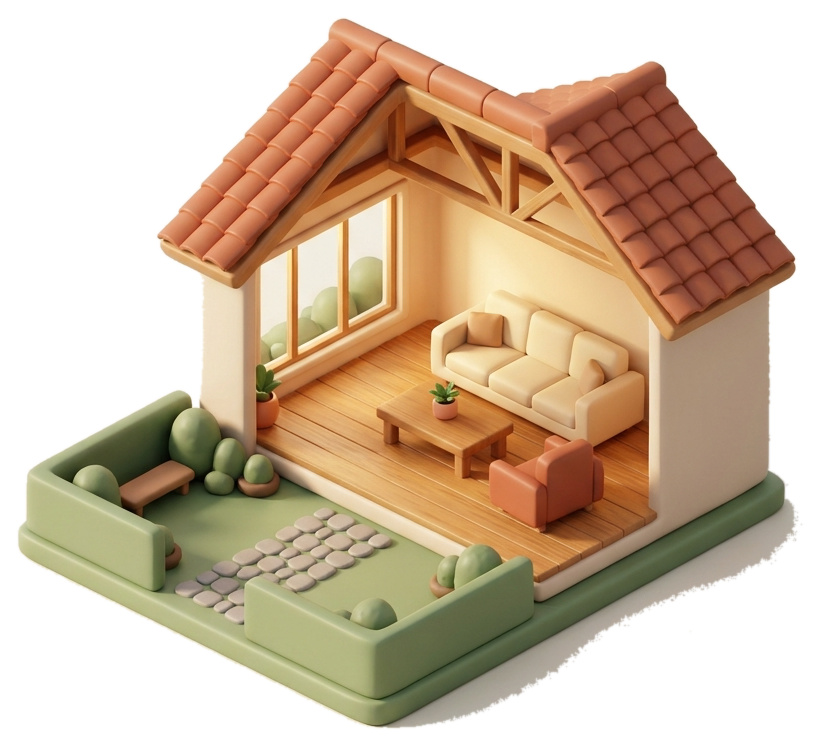
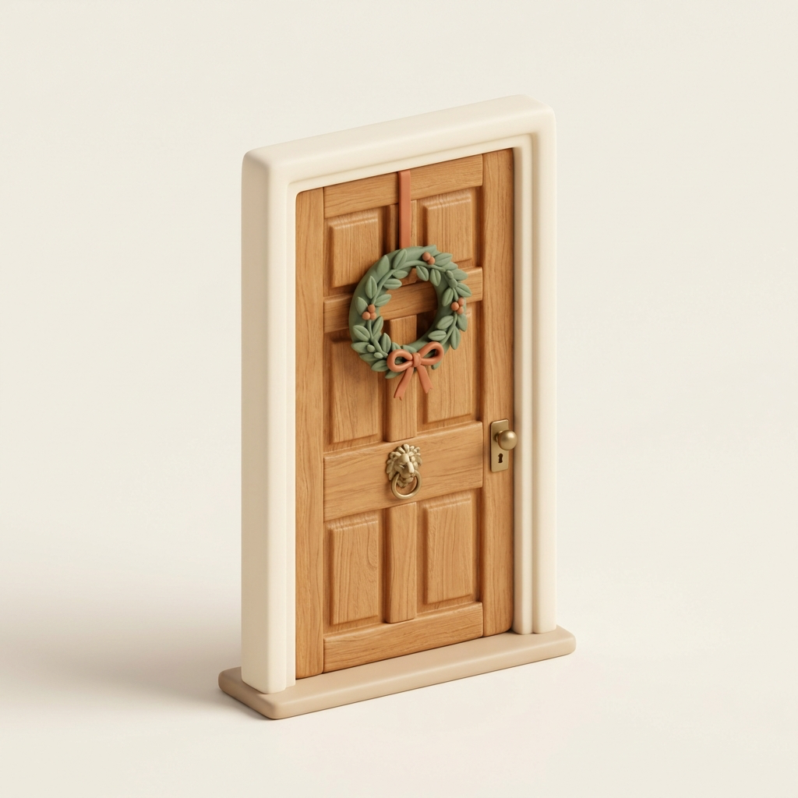
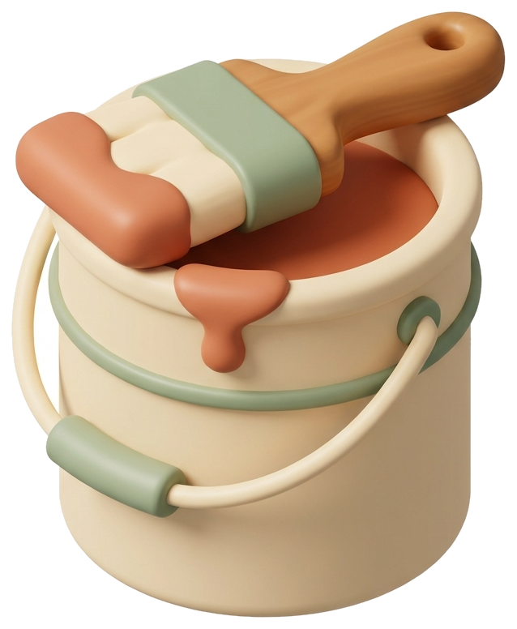
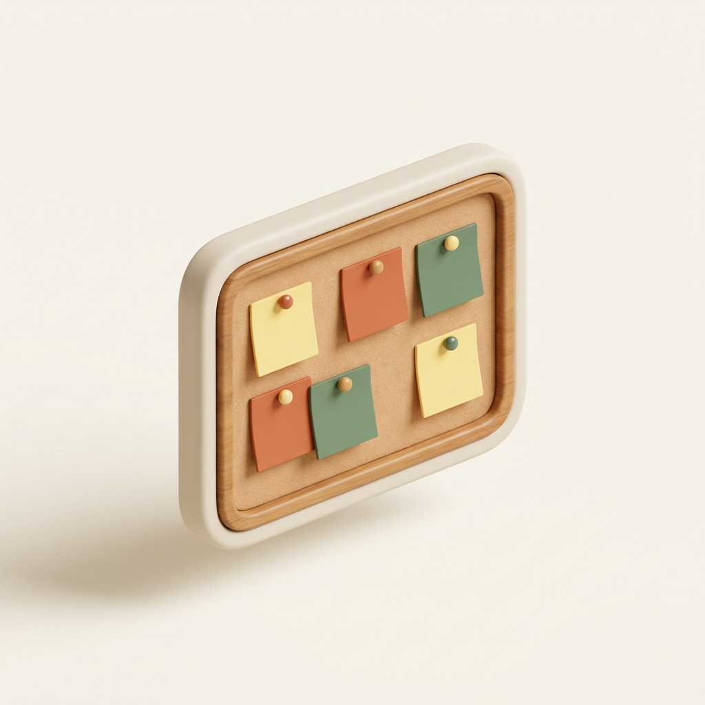
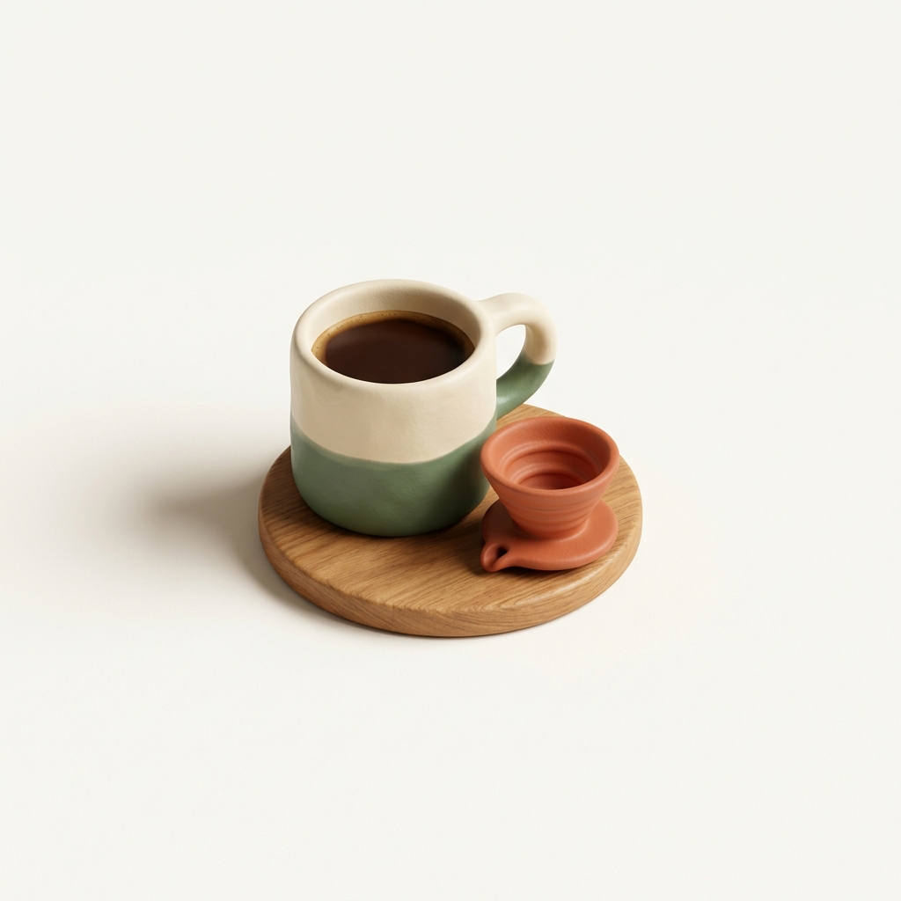
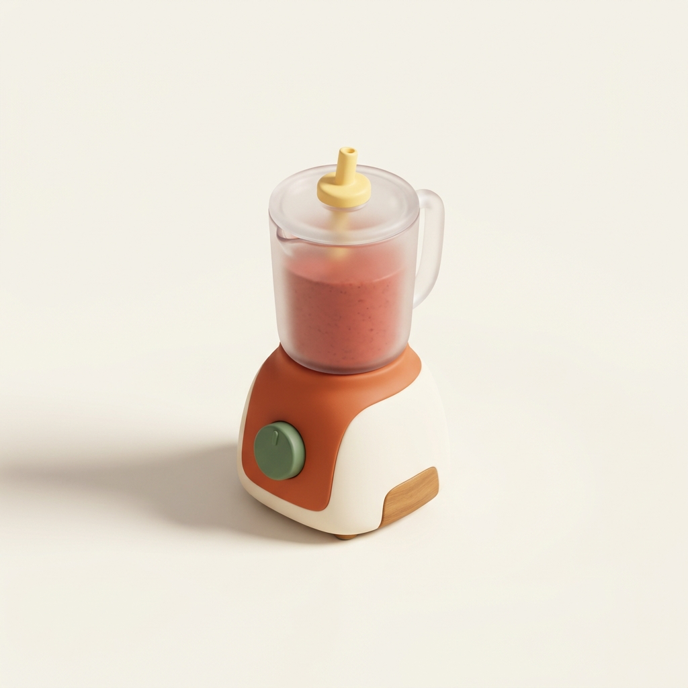
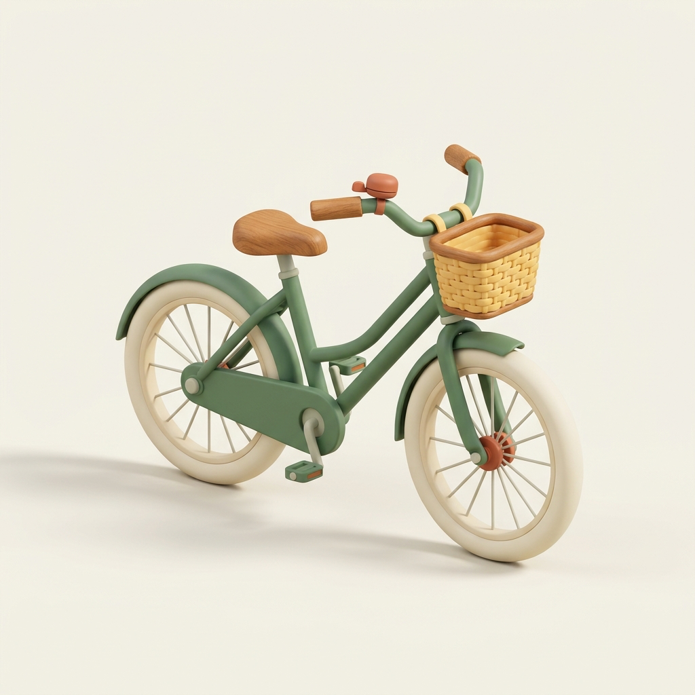
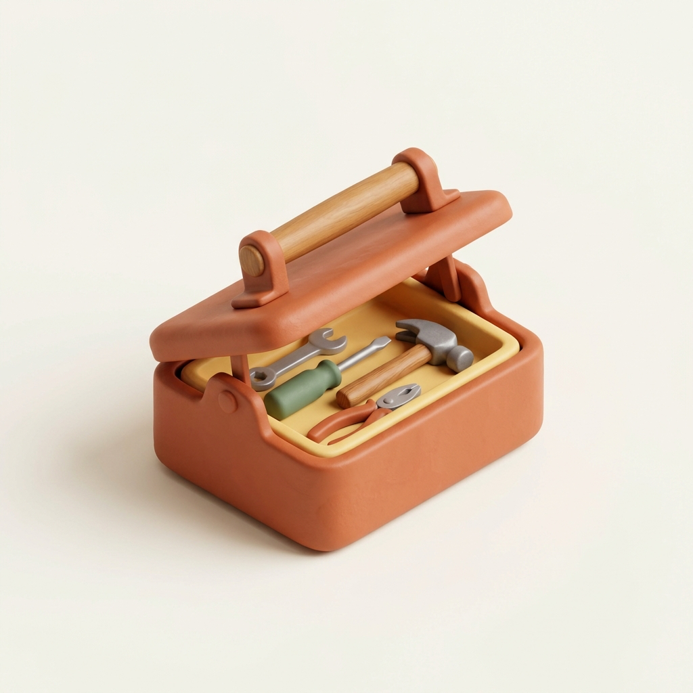
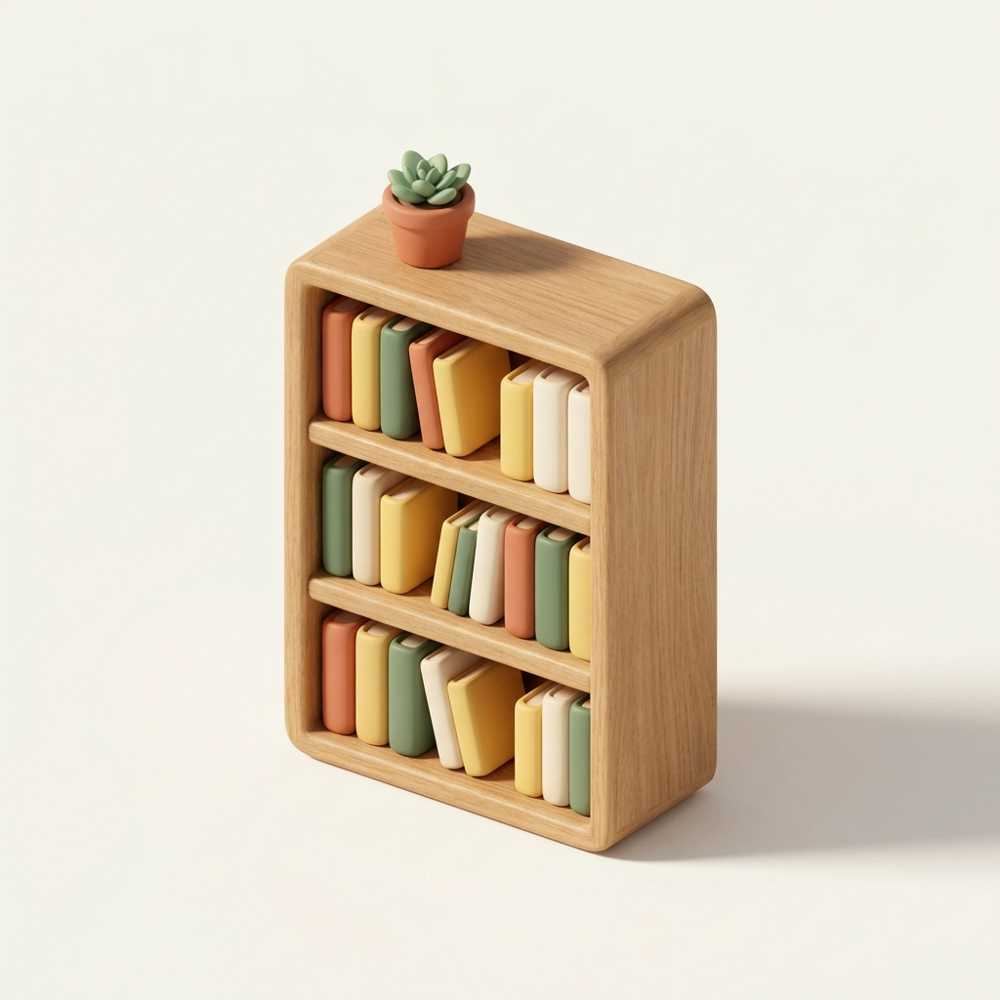

<div align="center">



# Domus

**Build your family's digital house.**

One warm, flexible claymorphic space to organize life at home — shared when you want, private when you need, shaped entirely by the people who live in it.

[](https://nextjs.org/)
[](https://react.dev/)
[](https://www.typescriptlang.org/)
[](https://orm.drizzle.team/)

</div>

---

## What Is Domus?

Most family apps force you to choose between rigid corporate project boards and messy chat threads. **Domus** models your home the way a real house actually works:

- **One House Key, Personal Room Keys**: Creating a residence automatically mints a unique **House Key** (e.g., `DOMUS-4821`) for the entire home and a personal **Room Key** for the Head of Household. Every invited family member receives the same House Key plus their own minted Room Key.
- **Spatial Common Area**: Walk straight into your house's Common Area — no splash cards, no cluttered top nav tabs. Manage **Family Doors**, **Shared Family Lists**, and the **Family Calendar** side-by-side.
- **Private Personal Rooms**: Every family member owns a personal room behind their door — **Locked** by default (family can knock quietly or with a note) or switched **Open** in 1 click.

---

## Key Features

<table>
  <tr>
    <td width="50%" valign="top">
      <h3> Spatial Family Doors &amp; Knocking</h3>
      <ul>
        <li>Every family member has a 2.5D door in the Common Area hallway.</li>
        <li>Click your own door to step straight into your Private Room.</li>
        <li>Click another member's locked door to <strong>Knock Quietly (no note)</strong> or <strong>Knock with a Note</strong>.</li>
        <li>Incoming knocks appear in the header bell &amp; room banner with 1-click <strong>Let In</strong>, <strong>Not Now</strong>, or <strong>Close Door</strong> — and locked doors automatically re-lock behind a visitor as soon as they exit.</li>
        <li>Head &amp; Co-Head can invite new members (Co-Head, Family Member, Guest / Helper) and copy both House Key &amp; Room Key in 1 click.</li>
      </ul>
    </td>
    <td width="50%" valign="top">
      <h3> Unrestricted Shared Family Lists</h3>
      <ul>
        <li>Create any shared list for the whole home (groceries, meal prep, errands, relative birthdays, home care) with 20 custom 2.5D clay miniatures.</li>
        <li>Smooth pointer-based <strong>drag-and-drop</strong> moves items seamlessly across lists.</li>
        <li><strong>Check / strikethrough</strong> items when done, or <strong>Clear</strong> a list to reuse it without deleting it.</li>
        <li>Set an independent <strong>List Date</strong> or click any task's calendar icon to schedule a day, time, and involved family members directly onto the Calendar.</li>
      </ul>
    </td>
  </tr>
  <tr>
    <td width="50%" valign="top">
      <h3> Multi-View Family &amp; Personal Calendar</h3>
      <ul>
        <li>Switch smoothly between <strong>Month</strong>, <strong>Week</strong>, and <strong>Day (Hourly Timeline)</strong> views.</li>
        <li>Animated <strong>All House | My Calendar</strong> switcher:
          <ul>
            <li><strong>All House</strong>: Shared family meetings, multi-person events (e.g., driving practice with a sibling), public holidays, yearly recurring birthdays, and dated lists.</li>
            <li><strong>My Calendar</strong>: Strictly private personal events plus any house events involving you.</li>
          </ul>
        </li>
        <li>Click any day (or <strong>Today</strong>) to open the full Day Schedule sheet.</li>
      </ul>
    </td>
    <td width="50%" valign="top">
      <h3> Private Rooms, Pinboard &amp; Earned Badges</h3>
      <ul>
        <li>Clear 2-state <strong>Locked | Open</strong> door switch on the far right of your room header.</li>
        <li><strong>Strict Read-Only Visits &amp; Visitor Guestbook</strong>: Visitors see the room owner's name and cannot modify their tasks, notes, goals, badges, or calendar — instead they can <strong>Like</strong> the room and leave friendly comments in the <strong>Visitor Guestbook</strong>, which trigger saved notifications in the room owner's header bell.</li>
        <li><strong>Personal Tasks</strong> with check/strikethrough and 1-click personal calendar scheduling.</li>
        <li><strong>Desk Notepad → Pinned Notes Board</strong>: Write and pin unlimited pastel sticky notes to your personal pinboard.</li>
        <li><strong>Personal Goals &amp; Habits</strong> with 2.5D progress rings, 100% completion cap, celebratory <strong>confetti</strong>, and persistent clickable <strong>Earned Badges</strong> (independent of goal deletion, with timestamp &amp; remove control).</li>
      </ul>
    </td>
  </tr>
  <tr>
    <td width="50%" valign="top">
      <h3> Living House Atmosphere</h3>
      <ul>
        <li><strong>Framed House Weather Window</strong> in the navbar showing live local weather via Open-Meteo (smiling sun, rain, snow, clouds, storm, starry night) with an interactive preview switcher.</li>
        <li><strong>Ticking Analog Wall Clock</strong> + live digital time in the navbar.</li>
        <li><strong>Wall Paint &amp; Wallpaper Studio</strong> accessible from the navbar's 2.5D Paint Bucket: 12 curated paints, dual-color custom mixer, 6 wallpaper patterns, and custom photo background upload.</li>
        <li><strong>Automatic Night Mode</strong> (7 PM – 6 AM) in a nocturnal slate-graphite palette with an on-demand <strong>Day / Night</strong> toggle.</li>
      </ul>
    </td>
    <td width="50%" valign="top">
      <h3> Production Auth &amp; Live Demo</h3>
      <ul>
        <li>Zero dummy data in production — clean SQLite database from day one.</li>
        <li>Dedicated <code>POST /api/demo</code> endpoint (<strong>Explore Live Demo</strong> on the Home Screen) spins up an isolated demo house with multi-role switching.</li>
        <li><code>scrypt</code> salted Room Key hashing, HMAC-SHA256 signed HTTP-only session cookies, and Recovery Email lookup.</li>
      </ul>
    </td>
  </tr>
</table>

---

## 2.5D Clay Miniature Library

All 20 custom matte-clay miniatures are available across Shared Lists, Personal Goals, and Calendar Events via the reusable `MiniaturePicker`:

<p align="center">
  
  
  
  
  
  
  
  
  
  
  
  
  
  
</p>

---

## Quick Start

```bash
# 1. Install dependencies
pnpm install

# 2. Start the development server
pnpm dev
# (Or specify a port: pnpm exec next dev --port 3005)

# 3. Typecheck & run unit tests
pnpm typecheck
pnpm test
```

Open **`http://localhost:3000`** (or your chosen port) to either **Create House**, **Enter House**, or click **Explore Live Demo**.

---

## Tech Stack

- **Framework**: Next.js 15 (App Router), React 19, TypeScript
- **Styling & Motion**: Tailwind CSS 3.4 (Claymorphic 2.5D design system + Nocturnal Dark Mode), Framer Motion, Lucide Icons
- **Database & ORM**: SQLite via `@libsql/client` + Drizzle ORM (`./data/domus.db`)
- **Validation & Security**: Zod, Node `crypto.scryptSync` password hashing, HMAC-SHA256 signed HTTP-only cookies
- **Weather**: Live local conditions via [Open-Meteo](https://open-meteo.com/) (no API key required)
- **Testing**: Vitest (`tests/rbac.test.ts`, `tests/schedule.test.ts`)

---

## Project Structure

```text
src/
├── app/
│   ├── api/              # Auth, demo, lists, calendar, rooms, knocks, boards, trackers
│   ├── globals.css       # Claymorphic 2.5D surfaces, Wall Paint variables & Night Mode
│   └── layout.tsx        # Root layout & typography
├── components/
│   ├── DomusApp.tsx          # Spatial shell, frosted glass navbar, Day/Night & Paint modal
│   ├── LoginView.tsx         # Split hero, floating 3D house, Entry/Create modal & Keycard
│   ├── CommonAreaView.tsx    # Hallway doors, list creator, draggable full-width Shared Lists
│   ├── FamilyCalendarPanel.tsx # Month/Week/Day calendar, Day Sheet & multi-person scheduling
│   ├── PersonalRoomView.tsx  # Door switch, tasks, Desk Notepad → Pinboard, Goals & Badges
│   ├── NavbarAtmosphere.tsx  # Framed House Weather Window & ticking Analog Wall Clock
│   ├── WallPaintModal.tsx    # 12 paints, custom mixer, 6 patterns & photo wallpaper upload
│   └── MiniaturePicker.tsx   # Universal 20-miniature 2.5D icon picker
├── db/                   # Drizzle schema & auto-migrating SQLite connection
└── lib/                  # Auth, RBAC, scheduling, holidays, miniatures, wallPaint, validation
```

---

## Maintainer & AI Agent Guidelines

> **IMPORTANT — Keep This README Updated**:
> Whenever you add, remove, or significantly change a feature, UI flow, API endpoint, or architectural convention in **Domus**, you **must** update `README.md` in the same commit (or immediately after) so documentation always reflects the live application. See [`AGENTS.md`](./AGENTS.md) for full contributor and AI agent instructions.
